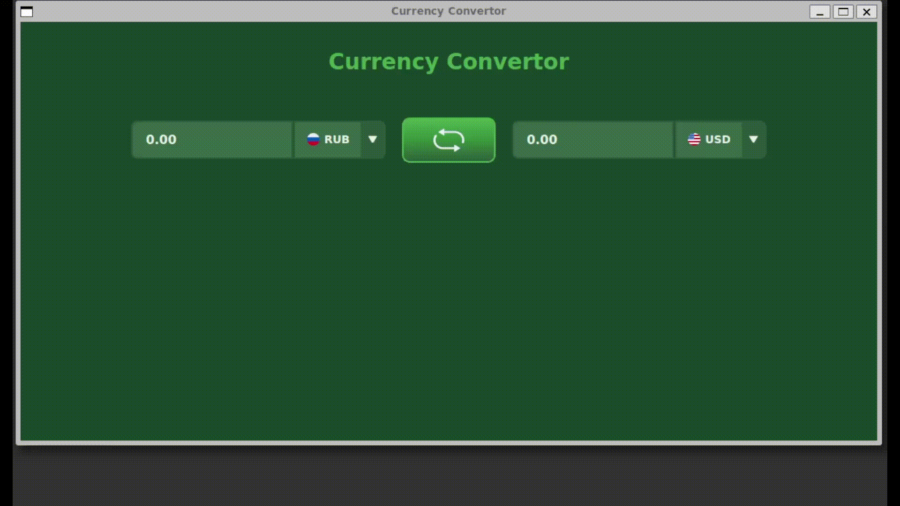

# Currency converter
This app can be described as a classic currency converter that uses open API to retrieve according valid currency data. Now it supports up to 10 the most commonly known along users currencies. The program is written on C++ language with application of Qt Framework and open API to retreive relevant currency data by request. Also, CSS was used for UI customization purposes.

# Installation and Configuration
In order to start using this app, it is necessary to accomplish the following steps:

1. Firstly, you need a relevant version of Qt5 being installed on your device;

2. Next clone this repo to get the source code of this app and all of the connected to it resources:
```markdown
git clone https://github.com/wisewalker/currency_converter.git
```
```markdown
git clone git@github.com:wisewalker/currency_converter.git
```
3. After that, choose the wished API that provides user the currency data by request in JSON data exchange format (recommended: https://www.exchangerate-api.com, v4 or newer). As soon as, you made your choice, please, enter the URL of your API into variable storing the path - `apiURL`. It is enclosed in the namespace `GlobalConstants`, which definition can be found inside the file `src/main.cpp`:
```cpp
namespace GlobalConstants {
    //App UI global parms
    const QString appName("Currency Convertor");
    const QSize mainWindowSize(480, 220);
    //API related parms
    const QString apiURL("*type your API URL*"");
}
```
4. When the configuration tasks mentioned above are finished, you can build the project and run it to observe the final result by yourself.

# Project Demo
